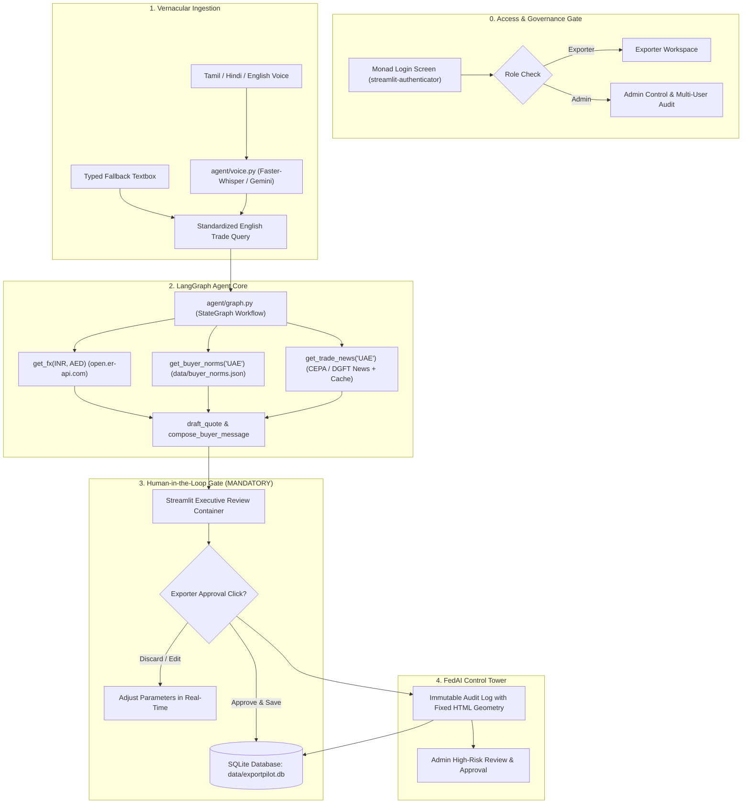

# 🚢 ExportPilot — India–UAE Trade Copilot

> **Tagline**: *Speak your deal. ExportPilot quotes it, checks the risk, and drafts the buyer message.*  
> **Championship Category**: Best Business AI Agent (Dubai Create AI Agents Championship)  
> **Live Demo**: [https://crazy-humans-jam.loca.lt](https://crazy-humans-jam.loca.lt) *(Tunnel Password / IP: `157.51.115.171`)*  
> **Hugging Face Space**: [https://huggingface.co/spaces/mr-sloth-04/export-pilot-india-uae-trade-copilot](https://huggingface.co/spaces/mr-sloth-04/export-pilot-india-uae-trade-copilot)  
> **Voice Ingestion**: Tamil, Hindi, English | **Operating Cost**: ₹0 (100% Free Tiers & Open Source)  
> **GitHub Repository**: [https://github.com/nobod-maker/ExportPilot--India-UAE-Trade-Copilot.git](https://github.com/nobod-maker/ExportPilot--India-UAE-Trade-Copilot.git)

---

## 🔑 Demo Access & Role Credentials

ExportPilot features full role-based access control (RBAC) and FedAI governance gating:

| Role | Username | Password | Features & Permissions |
| :--- | :--- | :--- | :--- |
| **Exporter** | `exporter` | `export123` | Multilingual voice deal desk, quotation calculator, export document compiler, adversarial risk auditor, corridor freight estimator, view personal audit logs. |
| **Administrator** | `admin` | `admin123` | Full access across all modules, view full multi-user audit log, and approve/reject high-risk pending actions. |

---

## 🌟 Executive Overview

Small Indian MSME exporters (garments, spices, leather, agro-commodities, engineering parts) face substantial hurdles when negotiating with Gulf/UAE buyers:
1. **Currency Volatility & Hidden Margin Loss**: Failing to price in exchange rate buffers when converting INR costs to UAE Dirhams (AED).
2. **Cultural & Commercial Norms**: Misalignments on UAE business protocols (Monday–Friday working week with Friday midday Juma break, Letter of Credit terms, formal business English).
3. **Vernacular Barrier**: Exporters naturally think and calculate in their mother tongue (Tamil, Hindi, English), but need instant, executive-grade international trade communications.
4. **Trade Regulatory Updates**: Tracking India–UAE CEPA (Comprehensive Economic Partnership Agreement) preferential tariffs and customs documentation.

**ExportPilot** solves this as an autonomous trade copilot:
- **Vernacular Ingestion**: Speaks Tamil, Hindi, or English via faster-whisper and Gemini Multimodal audio.
- **Live FX Intelligence**: Real-time INR/AED rates from `open.er-api.com` with automatic offline fallbacks.
- **Estimated FX Volatility Buffer**: Automatic $2.5\%$ currency buffer calculation to protect exporter margins.
- **Adversarial Risk Auditor**: Analyzes proposed payment terms, extracts retention percentages (e.g. 10% post-delivery vs 100% open account) and order scale, and advises why an exporter should reject hazardous terms or accept safe collateralized terms.
- **Export Document Agent**: Compiles export packing lists (cartons, weights, dimensions, HS codes) and UAE CEPA customs clearance checklists.
- **Corridor Freight Estimator**: Instant benchmark route transit times and freight costs (sea vs air) from Indian export hubs to Dubai/Jebel Ali.
- **FedAI Control Tower & Audit Log**: Immutably records every decision with unified fixed `<colgroup>` HTML table geometry, risk badges, and user attribution.
- **Enforces a strict Human-in-the-Loop (HITL) gate**: The agent prepares and calculates, but **never finalizes or saves deals without an explicit user approval click**.

---

## 🏛️ System Architecture



---

## ⚡ Zero-Cost Free-Tier Architecture

| Capability | Component / Source | Cost |
| :--- | :--- | :--- |
| **LLM & Voice Engine** | Google Gemini 2.5 Flash via `google-genai` SDK | ₹0 (Free Tier) |
| **Local Transcription** | `faster-whisper` (small / base model) | ₹0 (Local, offline) |
| **FX Rate Feed** | `open.er-api.com/v6/latest/INR` | ₹0 (Open, no API key required) |
| **Agent Orchestrator** | `langgraph` StateGraph | ₹0 (Open source) |
| **Data Storage** | Local SQLite (`data/exportpilot.db`) | ₹0 (Embedded) |
| **UI & Workbench** | Streamlit with Monad Design System | ₹0 (Open source) |
| **Trade Intelligence** | DGFT / PIB Feeds + Bundled Cache | ₹0 (Open data) |

---

## 📐 Transparent Impact Metrics & Formulas

Judges and business stakeholders require genuine, defensible calculations rather than black-box claims:

1. **Estimated FX Volatility Buffer Protected**:
   $$\text{Buffer Amount} = \text{Total AED} \times 2.5\%$$
   *Protects the MSME exporter against inter-bank currency fluctuations between quote issuance and Bill of Lading settlement.*

2. **Time to Quote Saved**:
   - *Manual Trade Workflow*: ~45 minutes (checking currency rates, looking up UAE customs holidays, calculating CIF freight, writing formal commercial proposal).
   - *ExportPilot Workflow*: **< 15 seconds** (>98% time reduction).

---

## 🚀 Quickstart & Local Setup

### 1. Prerequisites
- Python 3.11+
- Git

### 2. Clone and Install
```bash
git clone https://github.com/nobod-maker/ExportPilot--India-UAE-Trade-Copilot.git
cd ExportPilot--India-UAE-Trade-Copilot

# Install dependencies
pip install -r requirements.txt
```

### 3. Environment Variables (Optional for Offline Mode)
Create a `.env` file in the project root:
```env
GEMINI_API_KEY=your_gemini_api_key_here
GEMINI_MODEL=gemini-2.5-flash
```
> **Note**: ExportPilot includes a built-in offline fallback mode. If no API key is provided, the application runs fully and deterministically using heuristic extractors, cached trade news, and live FX feeds!

### 4. Run the Streamlit Copilot
```bash
python -m streamlit run app.py
```
Open `http://localhost:8501` in your browser.

---

## 🧪 Automated Test Suite

Every tool, agent node, and database schema has automated unit and end-to-end tests:
```bash
# 1. Run Core Unit & Database Tests (17 tests)
python -m pytest tests/test_tools.py tests/test_db.py tests/test_extended.py tests/test_graph.py tests/test_risk.py tests/test_voice.py

# 2. Run Playwright E2E Tests (Full browser automation)
python tests/run_playwright_e2e.py
```

---

## ☁️ Permanent Public Deployment

### Option A: Streamlit Community Cloud (Recommended — Free & 1-Click)
1. Go to [share.streamlit.io](https://share.streamlit.io/) and log in with GitHub.
2. Click **New App** and select:
   - **Repository**: `nobod-maker/ExportPilot--India-UAE-Trade-Copilot`
   - **Branch**: `main`
   - **Main file path**: `app.py`
3. In **Advanced Settings > Secrets**, paste:
   ```toml
   GEMINI_API_KEY = "your_key_here"
   GEMINI_MODEL = "gemini-2.5-flash"
   ```
4. Click **Deploy!** Your app will be live with a permanent URL like `https://exportpilot.streamlit.app`.

### Option B: Hugging Face Spaces (Free)
1. Create a new Space on [Hugging Face](https://huggingface.co/spaces) with **Streamlit** as the SDK.
2. Push the repository files (`app.py`, `agent/`, `data/`, `requirements.txt`, `README.md`).
3. Add `GEMINI_API_KEY` under **Space Settings > Variables and secrets**.
4. The space will build and launch automatically.

---

## 📜 Compliance & Safety Rules
- **Human-in-the-Loop Mandate**: ExportPilot drafts and calculates, but never sends or finalizes deals without an explicit approval click.
- **Data Protection**: Demo uses synthetic sample data only; zero sensitive customer or banking credentials stored.
