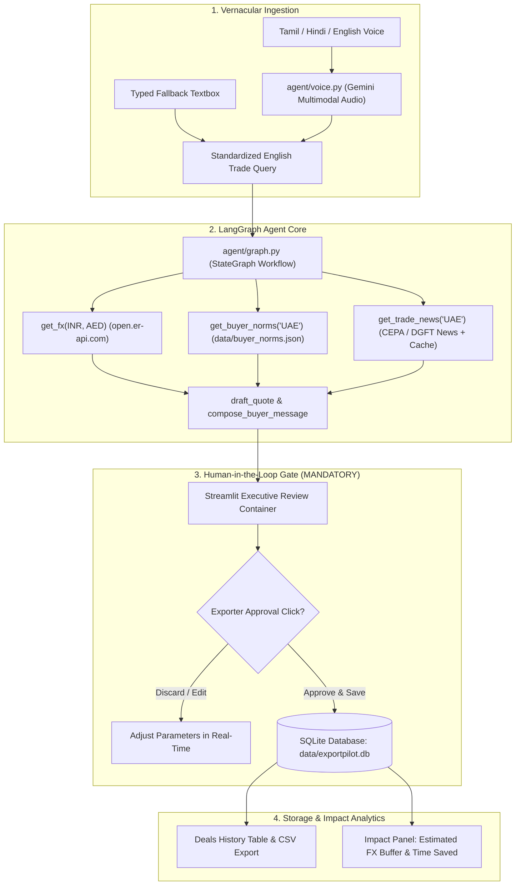

# 🚢 ExportPilot — India–UAE Trade Copilot

> **Tagline**: *Speak your deal. ExportPilot quotes it, checks the risk, and drafts the buyer message.*  
> **Championship Category**: Best Business AI Agent (Dubai Create AI Agents Championship)  
> **Demo**: Streamlit | **Voice**: Tamil, Hindi, English | **Operating Cost**: ₹0 (100% Free Tiers & Open Source)

---

## 🌟 Executive Overview

Small Indian MSME exporters (garments, spices, leather, agro-commodities, engineering parts) face substantial hurdles when negotiating with Gulf/UAE buyers:
1. **Currency Volatility & Hidden Margin Loss**: Failing to price in exchange rate buffers when converting INR costs to UAE Dirhams (AED).
2. **Cultural & Commercial Norms**: Misalignments on UAE business protocols (Monday–Friday working week with Friday midday Juma break, Letter of Credit terms, formal business English).
3. **Vernacular Barrier**: Exporters naturally think and calculate in their mother tongue (Tamil, Hindi, English), but need instant, executive-grade international trade communications.
4. **Trade Regulatory Updates**: Tracking India–UAE CEPA (Comprehensive Economic Partnership Agreement) preferential tariffs and customs documentation.

**ExportPilot** solves this as an autonomous trade copilot:
- Ingests **multilingual voice notes** (Tamil, Hindi, English) or typed text.
- Fetches **live INR/AED exchange rates** (`open.er-api.com`).
- Assesses **CEPA trade intelligence and shipping updates** (DGFT & Gulf feeds, with local cached fallback).
- Calculates a structured quotation with an **estimated FX volatility protection buffer**.
- Drafts culturally calibrated, professional English buyer emails.
- **Enforces a strict Human-in-the-Loop (HITL) gate**: The agent prepares and calculates, but **never finalizes or saves deals without an explicit user approval click**.

---

## 🏛️ System Architecture



---

## ⚡ Zero-Cost Free-Tier Architecture

| Capability | Component / Source | Cost |
| :--- | :--- | :--- |
| **LLM & Voice Engine** | Google Gemini 2.5 Flash via `google-genai` SDK | ₹0 (Free Tier) |
| **FX Rate Feed** | `open.er-api.com/v6/latest/INR` | ₹0 (Open, no API key required) |
| **Agent Orchestrator** | `langgraph` StateGraph | ₹0 (Open source) |
| **Data Storage** | Local SQLite (`data/exportpilot.db`) | ₹0 (Embedded) |
| **UI & Workbench** | Streamlit | ₹0 (Open source) |
| **Trade Intelligence** | DGFT / PIB Feeds + Bundled Cache | ₹0 (Open data) |

---

## 📐 Transparent Impact Metrics & Formulas

Judges and business stakeholders require genuine, defensible calculations rather than black-box claims:

1. **Estimated FX Volatility Buffer Protected**:
   $$\text{Buffer Amount} = \text{Total AED} \times 2.5\%$$
   *Protects the MSME exporter against inter-bank currency fluctuations between quote issuance and Bill of Lading settlement.*

2. **Time to Quote Saved**:
   - *Manual Trade Workflow*: ~45 minutes (checking currency rates, looking up UAE customs holidays, calculating CIF freight, writing formal commercial proposal).
   - *ExportPilot Workflow*: **< 15 seconds** (>98% time reduction).

---

## 🚀 Quickstart & Local Setup

### 1. Prerequisites
- Python 3.11+
- Git

### 2. Clone and Install
```bash
git clone https://github.com/your-username/exportpilot.git
cd exportpilot

# Install dependencies
pip install -r requirements.txt
```

### 3. Environment Variables (Optional for Demo)
Create a `.env` file in the project root:
```env
GEMINI_API_KEY=your_gemini_api_key_here
GEMINI_MODEL=gemini-2.5-flash
```
> **Note**: ExportPilot includes a built-in offline fallback mode. If no API key is provided, the application runs fully and deterministically using heuristic extractors, cached trade news, and live FX feeds!

### 4. Run the Streamlit Copilot
```bash
python -m streamlit run app.py
```
Open `http://localhost:8501` in your browser.

---

## 🧪 Automated Test Suite

Every tool, agent node, and database schema has automated unit tests.
```bash
python -m pytest tests/ -v
```

Current test suite coverage:
- `tests/test_tools.py`: Live & fallback FX conversion, UAE buyer norms, quote formulas, and SQLite persistence.
- `tests/test_graph.py`: LangGraph state machine, node transitions, and human approval status enforcement.
- `tests/test_risk.py`: Trade news parsing, source attribution, and risk rating.
- `tests/test_voice.py`: Multimodal audio processing and 30-sample vernacular benchmark evaluation.
- `tests/test_db.py`: SQLite schema validation and audit history integrity.

---

## ☁️ Hugging Face Spaces Deployment Guide

Deploying ExportPilot to Hugging Face Spaces takes under 3 minutes:

1. Create a new Space on [Hugging Face](https://huggingface.co/spaces) with **Streamlit** as the SDK.
2. Push the repository files (`app.py`, `agent/`, `data/`, `requirements.txt`, `README.md`).
3. Add your Gemini API key in **Space Settings > Variables and secrets**:
   - `GEMINI_API_KEY`: `AIzaSy...`
   - `GEMINI_MODEL`: `gemini-2.5-flash`
4. The space will automatically install `requirements.txt` and launch the live public app!
> **Security Reminder**: Never commit your `.env` file to Git or public repositories. Use Hugging Face Secrets.

---

## 📜 Compliance & Safety Rules
- **Human-in-the-Loop Mandate**: ExportPilot drafts and calculates, but never sends or finalizes deals without an explicit approval click.
- **Data Protection**: Demo uses synthetic sample data only; zero sensitive customer or banking credentials stored.
